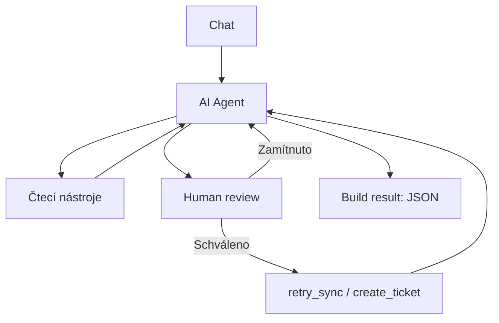

# FABINI – AI Operations Agent

Kamil Antoníček · Case study · 16. 10. 2026

Připravil jsem prototyp agenta, který z dotazu v chatu zjistí stav objednávky, dohledá problém a podle požadavku navrhne postup nebo provede schválenou akci. Všechno běží nad mock daty v n8n.

## Jak jsem k tomu přistoupil

Zvolil jsem n8n, protože je v něm dobře vidět, co agent volá a co jednotlivé kroky vracejí. Nejdřív jsem zprovoznil čtení objednávek, potom opravu synchronizace se schválením a nakonec vytváření incidentů a chybové scénáře.

Pro simulaci mi stačí jedna tabulka objednávek a jedna tabulka incidentů. Každý nástroj má vlastní pomocné workflow a vrací jen potřebná data. Později by šlo čtení tabulky nahradit voláním skutečného API.

Chtěl jsem, aby model vybíral nástroje podle dotazu a výsledků. Podmínky pro změny jsem ale dal i přímo do workflow, aby bezpečnost nestála jen na system message.

## Jak to funguje

Hlavní workflow přijme zprávu, AI Agent zavolá nástroje a uzel **Build result** sestaví finální JSON.




| Nástroj           | K čemu slouží                       |
| ----------------- | ----------------------------------- |
| `get_order`       | Stav objednávky.                    |
| `get_payment`     | Stav platby.                        |
| `get_fulfillment` | Stav předání skladu.                |
| `get_sync_logs`   | Stav a historie synchronizace.      |
| `retry_sync`      | Simulované opakování synchronizace. |
| `create_ticket`   | Vytvoření incidentu.                |


Poslední dva nástroje vyžadují **Human review** v chatu. Při zamítnutí se změna neprovede. Retry navíc vyžaduje současně `paid`, `not_received`, `failed` a `sync_retry_count = 0`. Po úspěchu agent znovu ověří logy a stav skladu.

Původní chyba v `sync_logs` zůstává jako historie. Aktuální výsledek opravy určuje `sync_status` a následná kontrolní čtení. U objednávky `100247` je výpadek logů nastavený přímo v kódu `get_sync_logs`; agent v tomto scénáři uložený stav synchronizace nedostane.

Agent má limit 10 iterací. Automatické opakování zápisů je vypnuté. Incident se při opakovaném volání se stejným `request_id` vrátí jako existující. Nová zpráva v chatu má nové ID, takže nejde o kontrolu duplicit podle objednávky.

Pro reálný provoz bych přidal samostatná pole pro objednávku a typ problému a kontroloval, jestli už stejný problém nemá otevřený incident.

## Spuštění

### 1. Prostředí a model

Je potřeba n8n s **Data Tables** a **Human review** pro nástroje v chatu. Použil jsem OpenAI Chat Model s `gpt-5.4-mini`. V uzlu **OpenAI Chat Model** nastavte vlastní přístup k modelu.

### 2. Vytvoření tabulek

Tabulky i všech sedm workflow založte **ve stejném n8n projektu**.

Přes **Data tables → Create Data table → Import CSV** načtěte `data/orders-initial.csv`. Tabulku pojmenujte **Fabini - orders** a zkontrolujte typy:

| Sloupce | Typ |
|---|---|
| `order_id`, `order_status`, `payment_status`, `fulfillment_status`, `sync_status`, `sync_logs` | String |
| `sync_retry_count` | Number |

**`order_id` musí být String.** Pokud po importu vidíte `order_id (number)`, typ neodpovídá exportům. Jestli při CSV importu nelze nastavit správné typy, založte tabulku přes **From scratch** podle této tabulky a vložte tři objednávky podle `data/orders-initial.json`.

**Fabini - incidents** vytvořte prázdnou se sloupci `request_id`, `status`, `description`, všechny **String**. `incidents-empty.csv` je jen vzor hlavičky. Názvy CSV souborů se nemění; uvedené názvy patří tabulkám uvnitř n8n. Sloupce `id`, `createdAt`, `updatedAt` doplňuje n8n samo.

### 3. Import workflow

1. Stáhněte repozitář přes **Code → Download ZIP** a rozbalte ho.
2. V n8n otevřete **nové prázdné workflow**. V nabídce tří teček v editoru vyberte **Import from File**.
3. Importujte `workflows/02-get-order.json` a změny uložte, případně vyčkejte na automatické uložení.
4. Stejně importujte soubory `03` až `07`, **každý do vlastního nového workflow**.
5. Nakonec samostatně importujte `workflows/01-main.json`.

Výsledkem má být sedm samostatných workflow.

### 4. Výběr tabulek po importu

Exporty obsahují původní ID tabulek. **I když pole už zobrazuje správný název, rozbalte Data table a znovu vyberte svoji nově vytvořenou tabulku.** Stejný název automaticky neznamená stejnou tabulku.

| Workflow | Uzel | Tabulka |
|---|---|---|
| Pomocná workflow `02` až `06` | **Find order** | Fabini - orders |
| `06-retry-sync.json` | **Apply sync retry** | Fabini - orders |
| `07-create-ticket.json` | **Find ticket**, **Insert ticket** | Fabini - incidents |

Pokud mají dvě tabulky stejný název, otevřete novou tabulku a ověřte její ID v adrese. V uzlu lze místo **From list** použít **By ID** a zadat toto nové ID.

**Když se ukáže „Error fetching options“ nebo „Data table with ID … could not be found in this project“:**

1. Ověřte, že vybíráte tabulku z aktuálního projektu.
2. V poli **Data table** znovu vyberte správnou tabulku.
3. U pole **Column** klikněte na tři tečky a zvolte **Refresh List**.
4. Pokud je potřeba, obnovte podmínku podle následující tabulky. Hodnotu vložte jako **Expression**.

| Uzel | Column | Condition | Value |
|---|---|---|---|
| Find order | `order_id (string)` | Equals | `{{ String($json.order_id ?? '').trim() }}` |
| Find ticket | `request_id (string)` | Equals | `{{ $json.request_id }}` |

V těchto čtecích uzlech ponechte **Return All vypnuté** a limit **1**. Po změně lze uzel zavřít a znovu otevřít, aby se načetly aktuální možnosti.

V zapisujících uzlech zachovejte ruční mapování z exportu: **Apply sync retry** mění `sync_status`, `fulfillment_status`, `sync_retry_count` a přidává záznam do `sync_logs`. Jeho filtr musí dál spojovat **All Conditions**: `order_id` odpovídá `{{ $json.order_id }}` a `sync_retry_count` je `0`. **Insert ticket** zapisuje `request_id`, `status` a `description`. Zůstává vypnuté automatické opakování zápisu a připojený chybový výstup.

### 5. Výběr pomocných workflow v hlavním agentovi

V hlavním workflow otevřete postupně všech šest nástrojů. V poli **Workflow / From list** znovu vyberte odpovídající **nově importované** workflow:

| Nástroj | Soubor pomocného workflow |
|---|---|
| `get_order` | `02-get-order.json` |
| `get_payment` | `03-get-payment.json` |
| `get_fulfillment` | `04-get-fulfillment.json` |
| `get_sync_logs` | `05-get-sync-logs.json` |
| `retry_sync` | `06-retry-sync.json` |
| `create_ticket` | `07-create-ticket.json` |

Při dvou stejných názvech ověřte cílové workflow podle jeho ID v adrese; nevybírejte jen podle pořadí v seznamu. Místo výběru ze seznamu lze zadat ID nového workflow. Je-li potřeba, přes **Refresh** obnovte **Workflow Inputs** a zkontrolujte mapování:

- `order_id` u objednávkových nástrojů: **Defined automatically by the model**.
- `description` u `create_ticket`: vyplňuje model.
- `request_id` u `create_ticket`: výraz **`{{ $execution.id }}`**, doplňuje workflow.

Interní `request_id` jsem přidal oproti zadání kvůli kontrole duplicit v jednom běhu. `retry_sync` a `create_ticket` musí zůstat připojené přes schvalovací uzel **Chat**.

### 6. Publikování a vyzkoušení

Pro provoz mimo testovací chat nejprve publikujte všech šest pomocných workflow a potom hlavní workflow. Po dalších úpravách publikujte aktuální verzi znovu.

Pokud nástroj vrátí **„Workflow is not active and cannot be executed“**, ověřte jeho výběr v hlavním workflow. Otevřete skutečně vybrané pomocné workflow a klikněte na **Publish**, případně **Active** podle verze n8n. Potom spusťte nový požadavek z hlavního chatu.

Pro první kontrolu použijte:

```text
Zjisti, proč objednávka 100246 nebyla expedována. Proveď pouze diagnostiku, nic neměň.
```

Očekávaný výsledek je čekání na zaplacení a žádný zápis. Další dva scénáře a reset dat jsou v [SCENARIOS.md](docs/SCENARIOS.md).

Dokumentace n8n: [import workflow](https://docs.n8n.io/workflows/export-import/), [Data Tables](https://docs.n8n.io/data/data-tables/) a [Call n8n Workflow Tool](https://docs.n8n.io/integrations/builtin/cluster-nodes/sub-nodes/n8n-nodes-langchain.toolworkflow/).

## Výstupy a soubory

Finální JSON je v **Build result → Output → JSON**. Obsahuje `request_id`, `environment`, odpověď v `summary`, skutečná volání v `steps` a chyby v `errors`. Historie běhů se ukládá také v n8n.

- `examples/` – tři skutečné výstupy uzlu **AI Agent**, včetně `intermediateSteps`. Dotazy jsou v dokumentaci scénářů.
- `data/orders-initial.csv` – výchozí data pro demo. `observed-*.csv` zachycují stav po testech.
- JSONy ve složce `data/` – přehled dat a sloupců pro ruční založení. Pro spuštění stačí CSV a výše uvedené nastavení tabulek. `incidents-empty.csv` obsahuje jen hlavičku.
- [VERIFICATION.md](docs/VERIFICATION.md) – co bylo ověřeno a co zůstává mimo tento prototyp.


## Rozsah řešení a pomoc AI

Jde o funkční prototyp. Před nasazením by bylo potřeba napojit skutečné systémy, dořešit souběžné zápisy, timeouty a monitoring. Chat nemá paměť, proto každý dotaz potřebuje číslo objednávky. Stav `received` znamená přijetí skladem, ne odeslání zákazníkovi.

S ClaudeCode jsem řešil hledání chyb i tvorbu výsledné dokumentace. Workflow jsem sestavoval a manuálně zkoušel ve své instanci n8n.