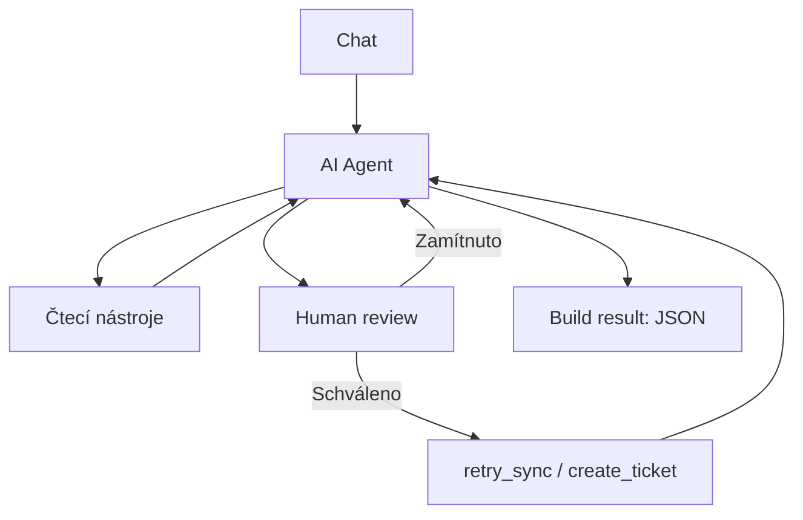

# FABINI – AI Operations Agent

Kamil Antoníček · Case study · Aktualizace 17. 10. 2026

Připravil jsem prototyp agenta, který z dotazu v chatu zjistí stav objednávky, dohledá problém a podle požadavku navrhne postup nebo provede schválenou akci. Všechno běží nad mock daty v n8n.

## Jak jsem k tomu přistoupil

Zvolil jsem n8n, protože je v něm dobře vidět, co agent volá a co jednotlivé kroky vracejí. Nejdřív jsem zprovoznil čtení objednávek, potom opravu synchronizace se schválením a nakonec vytváření incidentů a chybové scénáře.

Pro simulaci mi stačí jedna tabulka objednávek a jedna tabulka incidentů. Každý nástroj má vlastní pomocné workflow a vrací jen potřebná data. Později by šlo čtení tabulky nahradit voláním skutečného API.

Chtěl jsem, aby model vybíral nástroje podle dotazu a výsledků. Podmínky pro změny jsem ale dal i přímo do workflow, aby bezpečnost nestála jen na system message.

## Jak to funguje

Hlavní workflow přijme zprávu, AI Agent zavolá nástroje a uzel **Build result** sestaví finální JSON.

| Nástroj           | K čemu slouží                       |
| ----------------- | ----------------------------------- |
| `get_order`       | Stav objednávky.                    |
| `get_payment`     | Stav platby.                        |
| `get_fulfillment` | Stav předání skladu.                |
| `get_sync_logs`   | Stav a historie synchronizace.      |
| `retry_sync`      | Simulované opakování synchronizace. |
| `create_ticket`   | Vytvoření incidentu.                |

Poslední dva nástroje vyžadují **Human review** v chatu. Při zamítnutí se změna neprovede. Retry navíc vyžaduje současně `paid`, `not_received`, `failed` a `sync_retry_count = 0`. Po úspěchu agent znovu ověří logy a stav skladu.

Původní chyba v `sync_logs` zůstává jako historie. Aktuální výsledek opravy určuje `sync_status` a následná kontrolní čtení. U objednávky `100247` je výpadek logů nastavený přímo v kódu `get_sync_logs`; agent v tomto scénáři uložený stav synchronizace nedostane.

Agent má limit 10 iterací. Automatické opakování zápisů je vypnuté. Oproti zadání jsem k `create_ticket(description)` přidal interní `request_id`. Incident se při opakovaném volání se stejným `request_id` vrátí jako existující. Nová zpráva v chatu má nové ID, takže nejde o kontrolu duplicit podle objednávky.

Pro reálný provoz bych přidal samostatná pole pro objednávku a typ problému a kontroloval, jestli už stejný problém nemá otevřený incident.

## Spuštění

Je potřeba n8n s **Data Tables** a **Human review**. Modelový uzel používá `gpt-5.4-mini`; přístup k modelu je potřeba nastavit vlastní.

1. Stáhněte repozitář přes **Code → Download ZIP** a rozbalte ho.
2. Ve stejném n8n projektu vytvořte tabulku **Fabini - orders** z `data/orders-initial.csv` a prázdnou **Fabini - incidents**. Typy sloupců jsou níže; celé schéma je v [table-schema.json](data/table-schema.json).
3. V editoru přes **Import from File** importujte pomocná workflow `02` až `07`, každé do nového prázdného workflow. Nakonec samostatně importujte `01-main.json`.
4. Znovu vyberte vytvořené tabulky v pomocných workflow a nově importovaná workflow v nástrojích hlavního agenta. Zkontrolujte **Workflow Inputs** a nastavte model.
5. Otevřete testovací chat a použijte dotazy ze [SCENARIOS.md](docs/SCENARIOS.md). Pro provoz mimo testovací chat nejprve publikujte pomocná workflow a potom hlavní workflow.

| Tabulka | Vlastní sloupce a typy |
|---|---|
| Fabini - orders | `order_id`, `order_status`, `payment_status`, `fulfillment_status`, `sync_status`, `sync_logs`: **String**; `sync_retry_count`: **Number**. |
| Fabini - incidents | `request_id`, `status`, `description`: **String**. |

`id`, `createdAt` a `updatedAt` vytváří n8n samo. `incidents-empty.csv` je jen vzor hlavičky prázdné tabulky.

**Přesné propojení uzlů, výrazy pro vstupy a řešení hlášek jsou v [návodu po importu](docs/TROUBLESHOOTING.md).** Návod vychází z exportů, zaznamenaných potíží při importu a dokumentace n8n. Celý běh po importu do druhé čisté instance zatím ověřený není; rozsah kontrol popisuje [VERIFICATION.md](docs/VERIFICATION.md).

## Výstupy a soubory

Finální JSON je v **Build result → Output → JSON**. Obsahuje `request_id`, `environment`, odpověď v `summary`, skutečná volání v `steps` a chyby v `errors`. Historie běhů se ukládá také v n8n.

- `examples/` – tři skutečné výstupy uzlu **AI Agent**, včetně `intermediateSteps`. Dotazy jsou v dokumentaci scénářů.
- `data/orders-initial.csv` – výchozí data pro demo. `observed-*.csv` zachycují stav po testech.
- JSONy ve složce `data/` – přehled dat a sloupců pro ruční založení. Pro spuštění stačí CSV a výše uvedené nastavení tabulek. `incidents-empty.csv` obsahuje jen hlavičku.
- [VERIFICATION.md](docs/VERIFICATION.md) – co bylo ověřeno a co zůstává mimo tento prototyp.
- [TROUBLESHOOTING.md](docs/TROUBLESHOOTING.md) – propojení po importu, přesné vstupy a řešení chybových hlášek.

## Rozsah řešení a pomoc AI

Jde o funkční prototyp. Před nasazením by bylo potřeba napojit skutečné systémy, dořešit souběžné zápisy, timeouty a monitoring. Chat nemá paměť, proto každý dotaz potřebuje číslo objednávky. Stav `received` znamená přijetí skladem, ne odeslání zákazníkovi.

S ClaudeCode jsem řešil hledání chyb i tvorbu výsledné dokumentace. Workflow jsem sestavoval a manuálně zkoušel ve své instanci n8n.
