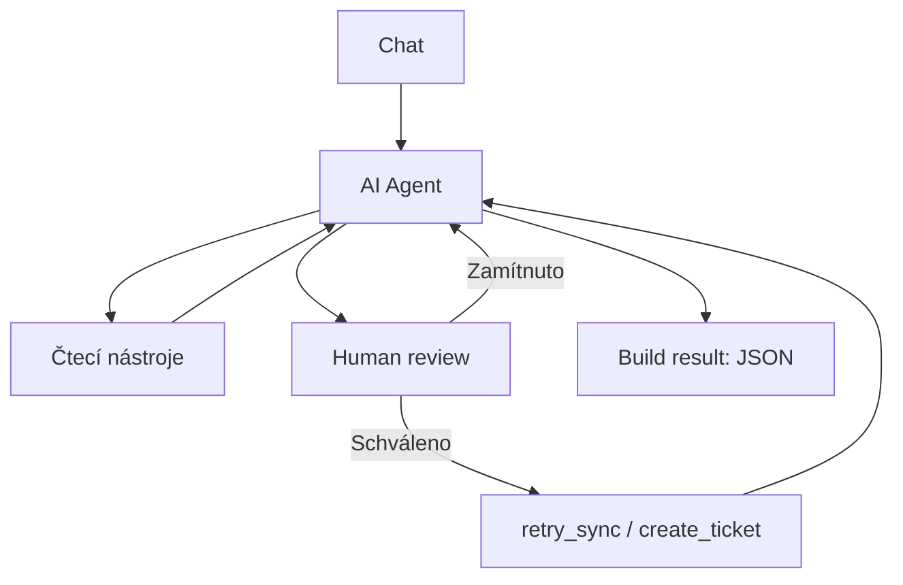

# FABINI – AI Operations Agent

Kamil Antoníček · Case study · 16. 10. 2026

Připravil jsem prototyp agenta, který z dotazu v chatu zjistí stav objednávky, dohledá problém a podle požadavku navrhne postup nebo provede schválenou akci. Všechno běží nad mock daty v n8n.

## Jak jsem k tomu přistoupil

Zvolil jsem n8n, protože je v něm dobře vidět, co agent volá a co jednotlivé kroky vracejí. Nejdřív jsem zprovoznil čtení objednávek, potom opravu synchronizace se schválením a nakonec vytváření incidentů a chybové scénáře.

Pro simulaci mi stačí jedna tabulka objednávek a jedna tabulka incidentů. Každý nástroj má vlastní pomocné workflow a vrací jen potřebná data. Později by šlo čtení tabulky nahradit voláním skutečného API.

Chtěl jsem, aby model vybíral nástroje podle dotazu a výsledků. Podmínky pro změny jsem ale dal i přímo do workflow, aby bezpečnost nestála jen na system message.

## Jak to funguje

Hlavní workflow přijme zprávu, AI Agent zavolá nástroje a uzel **Build result** sestaví finální JSON.

| Nástroj           | K čemu slouží                       |
| ----------------- | ----------------------------------- |
| `get_order`       | Stav objednávky.                    |
| `get_payment`     | Stav platby.                        |
| `get_fulfillment` | Stav předání skladu.                |
| `get_sync_logs`   | Stav a historie synchronizace.      |
| `retry_sync`      | Simulované opakování synchronizace. |
| `create_ticket`   | Vytvoření incidentu.                |

Poslední dva nástroje vyžadují **Human review** v chatu. Při zamítnutí se změna neprovede. Retry navíc vyžaduje současně `paid`, `not_received`, `failed` a `sync_retry_count = 0`. Po úspěchu agent znovu ověří logy a stav skladu.

Původní chyba v `sync_logs` zůstává jako historie. Aktuální výsledek opravy určuje `sync_status` a následná kontrolní čtení. U objednávky `100247` je výpadek logů nastavený přímo v kódu `get_sync_logs`; agent v tomto scénáři uložený stav synchronizace nedostane.

Agent má limit 10 iterací. Automatické opakování zápisů je vypnuté. Incident se při opakovaném volání se stejným `request_id` vrátí jako existující. Nová zpráva v chatu má nové ID, takže nejde o kontrolu duplicit podle objednávky.

Pro reálný provoz bych přidal samostatná pole pro objednávku a typ problému a kontroloval, jestli už stejný problém nemá otevřený incident.

## Spuštění

### 1. Prostředí a model

Je potřeba n8n s **Data Tables** a **Human review** pro nástroje v chatu. Použil jsem OpenAI Chat Model s `gpt-5.4-mini`. Přístup k modelu je potřeba nastavit vlastní.

### 2. Data

Ve stejném projektu vytvořte tabulku **Fabini - orders** přes **Data tables → Create Data table → Import CSV** ze souboru `data/orders-initial.csv`. Zkontrolujte typy:

| Sloupce                                                                                        | Typ    |
| ---------------------------------------------------------------------------------------------- | ------ |
| `order_id`, `order_status`, `payment_status`, `fulfillment_status`, `sync_status`, `sync_logs` | String |
| `sync_retry_count`                                                                             | Number |

Tabulku **Fabini - incidents** vytvořte prázdnou se sloupci `request_id`, `status`, `description`, všechny **String**. Sloupce `id`, `createdAt`, `updatedAt` doplňuje n8n samo.

### 3. Import a propojení

Přes **Import from File** nejdřív importujte pomocná workflow `02` až `07` ze složky `workflows/`, potom hlavní `01-main.json`. Po importu nastavte odkazy na nově vytvořené tabulky a workflow:

- V čtecích workflow a `retry_sync`: tabulka **Fabini - orders** v uzlech **Find order**, u retry také v **Apply sync retry**.
- V `create_ticket`: tabulka **Fabini - incidents** v uzlech **Find ticket** a **Insert ticket**.
- V hlavním workflow: u všech šesti nástrojů znovu vyberte odpovídající pomocné workflow a v **OpenAI Chat Model** nastavte přístup k modelu.

`order_id` a popis incidentu `description` vyplňuje model. Oproti zadání má `create_ticket(description)` navíc interní `request_id` pro kontrolu duplicit v jednom běhu; doplňuje ho workflow výrazem `{{ $execution.id }}`. Zapojení `retry_sync` a `create_ticket` ponechte přes schvalovací uzel **Chat**.

### 4. Vyzkoušení

V hlavním workflow otevřete testovací chat. Konkrétní dotazy, očekávané výsledky a reset dat jsou v [SCENARIOS.md](docs/SCENARIOS.md). Pro provoz mimo testovací chat je potřeba workflow publikovat.

## Výstupy a soubory

Finální JSON je v **Build result → Output → JSON**. Obsahuje `request_id`, `environment`, odpověď v `summary`, skutečná volání v `steps` a chyby v `errors`. Historie běhů se ukládá také v n8n.

- `examples/` – tři skutečné výstupy uzlu **AI Agent**, včetně `intermediateSteps`. Dotazy jsou v dokumentaci scénářů.
- `data/orders-initial.csv` – výchozí data pro demo. `observed-*.csv` zachycují stav po testech.
- JSONy ve složce `data/` – přehled dat a sloupců pro ruční založení. Pro spuštění stačí CSV a výše uvedené nastavení tabulek. `incidents-empty.csv` obsahuje jen hlavičku.
- [VERIFICATION.md](docs/VERIFICATION.md) – co bylo ověřeno a co zůstává mimo tento prototyp.

## Rozsah řešení a pomoc AI

Jde o funkční prototyp. Před nasazením by bylo potřeba napojit skutečné systémy, dořešit souběžné zápisy, timeouty a monitoring. Chat nemá paměť, proto každý dotaz potřebuje číslo objednávky. Stav `received` znamená přijetí skladem, ne odeslání zákazníkovi.

S ClaudeCode jsem řešil hledání chyb i tvorbu výsledné dokumentace. Workflow jsem sestavoval a manuálně zkoušel ve své instanci n8n.